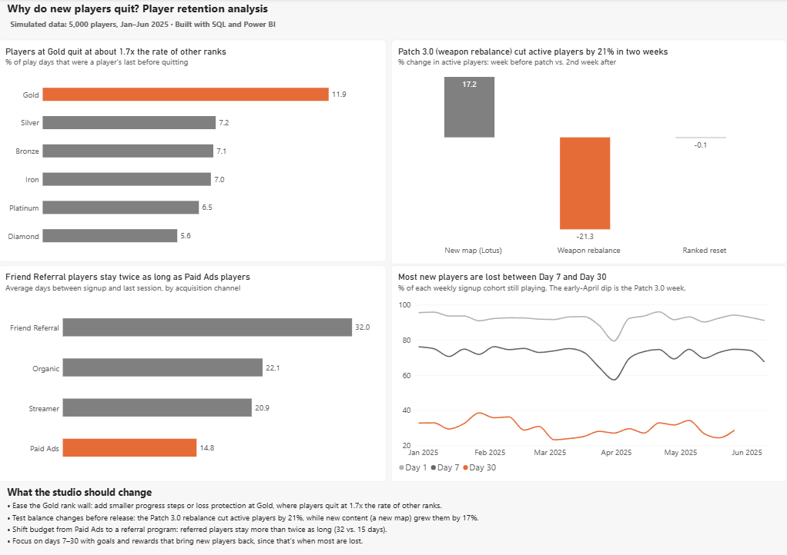

# Player Retention & Churn Analysis

**Business question: Why do new players quit, and what should the studio change?**

An end-to-end churn analysis of a simulated competitive shooter (5,000 players, ~175,000 matches, January–June 2025). I used Python to generate and clean the data, SQL to analyze it, and Power BI to build the dashboard.



## Key findings

1. **Gold is a "rank wall."** On any day a player is at Gold, there's an 11.9% chance it's their last day before quitting. That's about 1.7x the rate at Silver or Bronze (7.1–7.2%). ([query](sql/03_quit_rate_by_rank.sql))
2. **Patch 3.0 drove players away.** After the weapon rebalance, active players fell 21% within two weeks. The Patch 2.0 new map did the opposite and grew active players by 17%. ([query](sql/04_patch_impact.sql))
3. **Acquisition channel matters.** Friend Referral players stayed an average of 32 days, more than twice as long as Paid Ads players (15 days). Paid Ads players also had the highest churn rate (90%). ([query](sql/05_retention_by_channel.sql))
4. **Most new players are lost between Day 7 and Day 30.** About 92% of players return after Day 1 and 73% are still playing at Day 7, but only about 30% reach Day 30. Players who signed up the week of Patch 3.0 had the lowest early retention of any cohort (57% at Day 7). ([query](sql/08_cohort_retention.sql))
5. **Session length doesn't predict churn.** Churned and retained players both averaged about 76 minutes per session. Players weren't quitting because sessions were unengaging; churn was driven by specific triggers. ([query](sql/06_session_length.sql))

Supporting result: win rate rises from 43% to 57% as headshot accuracy increases ([query](sql/07_winrate_by_headshot.sql)). This is a correlation, not proof that aim causes wins, but it supports aim training as one way to help players progress.

## Recommendations

- **Ease the Gold rank wall.** Add smaller progress steps or loss protection at Gold, where players quit at 1.7x the rate of other ranks.
- **Test balance changes before release.** The Patch 3.0 rebalance cut active players by 21%, while new content (a new map) grew them by 17%. A public test server or staged rollout would catch this before it reaches everyone.
- **Shift budget from Paid Ads to a referral program.** Referred players stay more than twice as long (32 vs. 15 days).
- **Focus on days 7–30.** Goals and rewards in a player's second to fourth week target the window where most players are lost.

## Data

### Simulated data

The dataset is **simulated**, generated by [`generate_player_data.py`](generate_player_data.py) with a fixed random seed so results are reproducible. It models a free-to-play competitive shooter across four tables:

| Table | Rows | Columns |
|---|---|---|
| `players` | 5,000 | player_id, signup_date, region, platform, acquisition_channel |
| `matches` | 174,877 | match_id, player_id, match_date, map, agent, rank_tier, win, kills, deaths, headshot_pct |
| `sessions` | 57,417 | session_id, player_id, session_date, duration_min |
| `patches` | 4 | patch_id, release_date, note |

I built three churn drivers into the simulation on purpose: extra quitting at Gold rank, a harmful balance patch (3.0), and shorter player lifetimes for Paid Ads compared with Friend Referral. The goal of the project was to detect and size these drivers using SQL, the way an analyst would with real data, and to turn them into recommendations.

### Data cleaning

The raw data also includes deliberate quality problems, fixed in [`clean_data.py`](clean_data.py):

- ~100 missing `region` values → labelled "Unknown"
- Inconsistent map names (e.g. `"  bind "` vs `"Bind"`) → trimmed and title-cased
- ~1,750 missing `headshot_pct` values (~1% of matches) → filled with the median
- 50 duplicate session rows → removed

## Method

- **Churn definition:** a player has churned if they have no session in the last 14 days of the dataset (on or after 2025-06-17).
- **Day N retention:** the share of a signup cohort still playing on or after day N after signing up. Day 30 isn't measured for players who signed up after 2025-05-31.
- **Tools:**
  - **Python (pandas):** data generation and cleaning
  - **SQL (SQLite):** analysis with CTEs, joins, CASE logic and date functions. [`run_sql.py`](run_sql.py) loads the cleaned CSVs into an in-memory SQLite database, runs a query file, and saves the result to `output/`.
  - **Power BI Desktop:** dashboard built from the query results

## Repository structure

```
├── generate_player_data.py   # creates the simulated raw data
├── clean_data.py             # fixes data quality issues
├── run_sql.py                # runs a .sql file and saves the result as a CSV
├── data/                     # raw and cleaned CSVs
├── sql/                      # one query per business question
├── output/                   # query results (used by the dashboard)
└── dashboard/                # Power BI file and screenshot
```

## How to run

```bash
pip install pandas numpy
python generate_player_data.py
python clean_data.py
python run_sql.py sql/03_quit_rate_by_rank.sql          # run one query
for f in sql/*.sql; do python run_sql.py "$f"; done     # or run them all
```

To view the dashboard, open `dashboard/player_retention_dashboard.pbix` in Power BI Desktop. It loads the CSVs in `output/` from this repository.

## Limitations

- The data is simulated, with churn drivers built in on purpose. Real player data would be noisier, and the causes of churn would be harder to separate.
- The channel and headshot results are correlations. For example, referred players may stay longer because they were more interested to begin with, not because of the channel itself.
- The patch comparison is a simple before/after with no control group. A real analysis would also account for seasonality and the number of new signups each week.